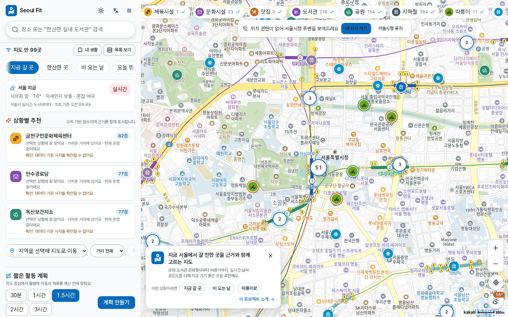
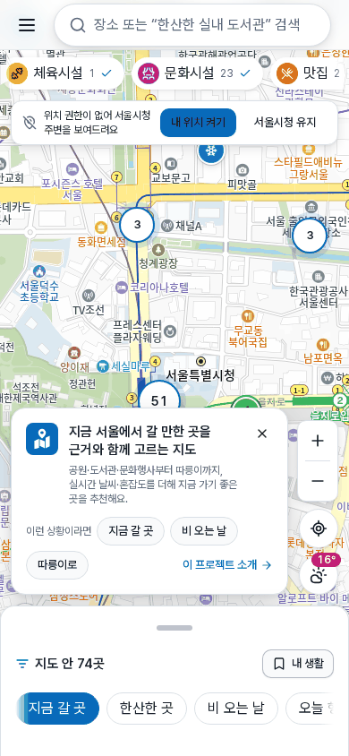
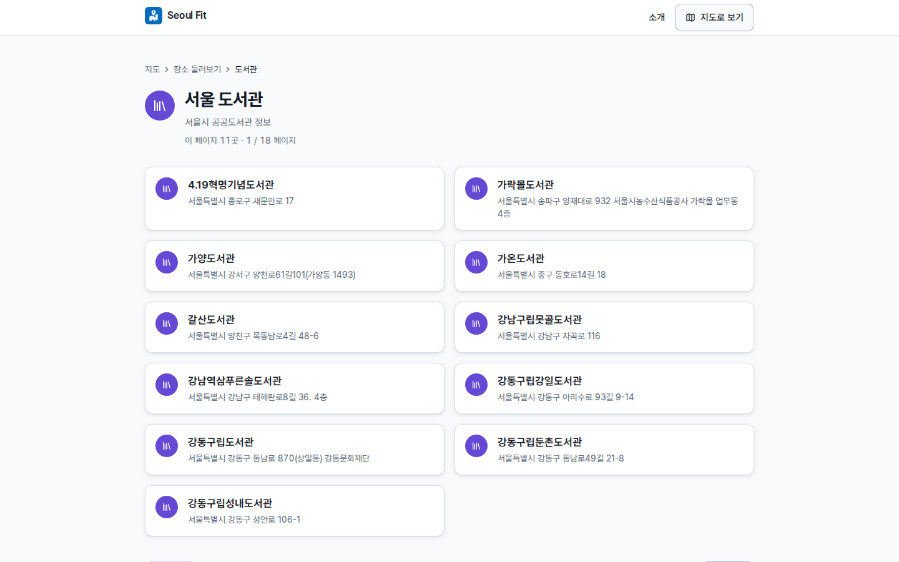
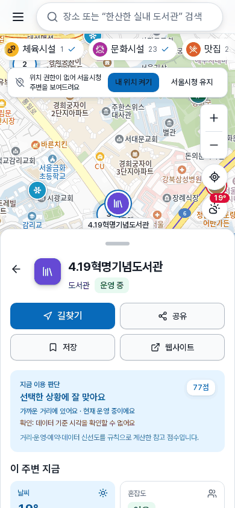
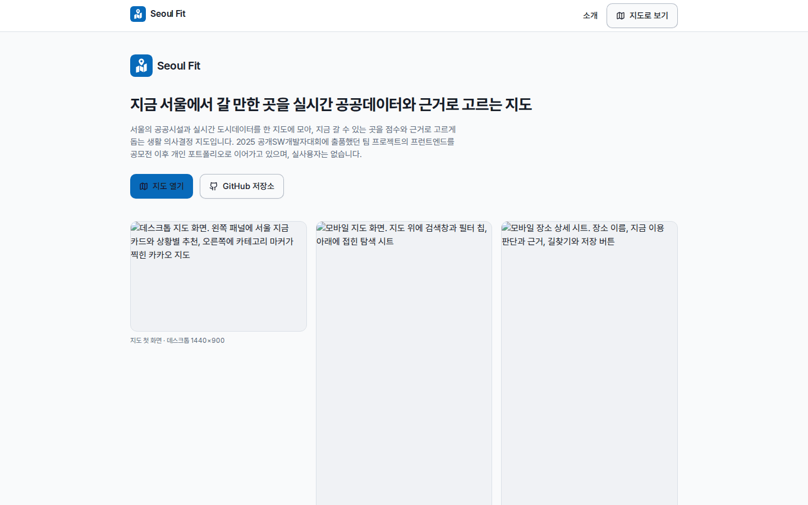
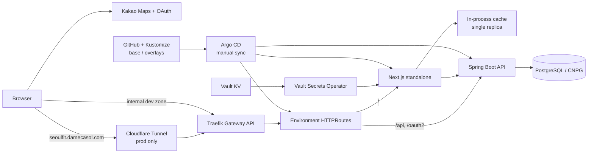

<p align="center">
  
</p>

# Seoul Fit (서울핏)

**지금 서울에서 갈 만한 곳을 실시간 공공데이터와 근거로 고르는 지도.**

공원·도서관·문화행사·무더위쉼터·따릉이·지하철과 지금의 날씨·혼잡도를 한 지도에
모아, "지금 갈 수 있는 곳"을 점수와 근거로 골라 주는 생활 의사결정 지도입니다.
2025 공개SW개발자대회에 출품했던 팀 프로젝트의 프런트엔드를 공모전 이후 개인
포트폴리오로 이어가고 있습니다. **실사용자와 트래픽은 없으며 포트폴리오 목적으로
운영합니다.**

**[서비스 바로가기 → seoulfit.damecasol.com](https://seoulfit.damecasol.com)** ·
[서비스 소개(/about)](https://seoulfit.damecasol.com/about) ·
[장소 둘러보기](https://seoulfit.damecasol.com/places)

바로 체험하는 딥링크 (로그인 없이 열립니다):

- [비 오는 날 실내](https://seoulfit.damecasol.com/?preset=rainy_day) — 실내
  장소를 강수 위험과 함께
- [지금 한산한 곳](https://seoulfit.damecasol.com/?preset=quiet) — 혼잡도가 낮은
  지역부터
- [오늘 열리는 행사](https://seoulfit.damecasol.com/?preset=today_event) — 오늘
  날짜의 문화행사·예약


-99424F>)


<p align="center">
  
</p>

## 이런 문제를 풉니다

| 지금의 문제                                                   | Seoul Fit의 해결                                                                                                            |
| ------------------------------------------------------------- | --------------------------------------------------------------------------------------------------------------------------- |
| 시설 정보는 흩어져 있고 "지금" 갈 수 있는지는 알려주지 않는다 | 9개 카테고리를 한 지도에 모으고, 운영 여부와 데이터 갱신 시각을 장소마다 붙인다                                             |
| 날씨·혼잡도는 다른 앱에서 따로 봐야 한다                      | 서울 실시간 도시데이터의 날씨·혼잡도를 "서울 지금" 카드로 묶고 추천의 감점 요인으로 쓴다                                    |
| 추천이 왜 나왔는지 알 수 없으면 믿기 어렵다                   | 규칙 기반 점수(0~100)와 근거 최대 3개·경고를 그대로 보여 준다. 데이터가 없으면 "정보 없음"으로 표시하고 0으로 채우지 않는다 |

## 화면

캡처는 `scripts/capture_screenshots.py`로 생성하며 카카오 로고·저작권이 잘리지
않게 남깁니다. (캡처일은 파일 생성 시 이 표에 기입)

| 데스크톱                                                           | 모바일                                                              |
| ------------------------------------------------------------------ | ------------------------------------------------------------------- |
|  |      |
|        |  |
|           |                                                                     |

## 체험 방법

| 로그인 없이 되는 것                                                         | 카카오 로그인이 필요한 것                      |
| --------------------------------------------------------------------------- | ---------------------------------------------- |
| 지도 탐색, 검색, 카테고리 필터, 서울 지금 카드, 6개 상황 프리셋과 추천 근거 | 관심 카테고리를 계정에 저장                    |
| 장소 상세: 길찾기·예약·공식 페이지·전화·공유                                | 저장한 장소와 생활권을 다른 기기에서 이어 쓰기 |
| 장소 저장 (이 기기에 보관), 짧은 활동 계획, 한국어·영어, 라이트·다크        | 생활권 알림 규칙과 인앱 알림                   |
| 공개 장소 페이지 `/places`, 서비스 소개 `/about`                            |                                                |

위치 권한이 없어도 서울시청 기준으로 동작합니다. 위치는 "내 위치" 버튼을 눌렀을
때만 요청합니다.

## 데이터를 다루는 원칙

- 모든 장소·실시간 값은 **서울 열린데이터광장(서울특별시)** 의 공공데이터이며,
  각 데이터셋의 공공누리 유형에 따라 출처를 표시하고 이용합니다.
- "실시간"은 원천 갱신 시각이 있고 정상 범위일 때만 씁니다. 오래됐거나 알 수
  없으면 `갱신 지연`·`기준 시각 미확인`으로 표시합니다.
- 없는 값을 0이나 기본값으로 채우지 않습니다. 운영시간을 모르면 "확인할 수
  없어요"라고 씁니다.
- 위치는 주변 탐색에만 쓰고 이동 궤적을 저장하지 않습니다. 분석 이벤트에는
  좌표·검색어·장소 식별자·계정 정보를 보내지 않습니다.

### 활용 데이터

| 데이터                               | 제공기관·서비스 ID                                                  | 쓰임                           | 갱신                          |
| ------------------------------------ | ------------------------------------------------------------------- | ------------------------------ | ----------------------------- |
| 서울 실시간 도시데이터 (날씨·혼잡도) | 서울 열린데이터광장 `citydata`, `citydata_ppltn`                    | 서울 지금 카드, 추천 위험 감점 | 요청 시 조회 + 서버 캐시      |
| 따릉이 대여소 실시간 현황            | 서울 열린데이터광장 `bikeList`                                      | 대여소 마커, 따릉이 프리셋     | 서버에서 1분마다              |
| 지하철역·실시간 도착                 | 서울 열린데이터광장 `subwayStationMaster`, `realtimeStationArrival` | 역 마커, 도착 정보             | 역 목록 시작 시, 도착 요청 시 |
| 주요 공원 현황                       | 서울 열린데이터광장 `SearchParkInfoService`                         | 공원 목록·상세·추천            | 백엔드 일 1회 배치            |
| 공공도서관 현황                      | 서울 열린데이터광장 `SeoulPublicLibraryInfo`                        | 도서관 목록·상세·추천          | 백엔드 일 1회 배치            |
| 문화행사·문화공간                    | 서울 열린데이터광장 `culturalEventInfo`, `culturalSpaceInfo`        | 행사 마커, 오늘 행사 프리셋    | 백엔드 일 1회 배치            |
| 공공서비스예약 (문화·체육)           | 서울 열린데이터광장 `ListPublicReservationCulture`, `…Sport`        | 예약 가능 프로그램             | 백엔드 일 1회 배치            |
| 무더위쉼터 현황                      | 서울 열린데이터광장 `TbGtnHwcwP`                                    | 더위 피하기 프리셋, 쉼터 목록  | 백엔드 일 1회 배치            |
| 관광 음식점                          | 서울 열린데이터광장 `TbVwRestaurants`                               | 맛집 목록·상세                 | 백엔드 일 1회 배치            |

### 고지

- 출처: 서울특별시, 서울 열린데이터광장(<https://data.seoul.go.kr>). 지도와
  로그인은 Kakao 지도 API와 카카오 로그인을 사용하며, 지도 타일과 로고는 Kakao의
  저작물입니다.
- 서울시가 운영하는 서비스가 아닌 개인 프로젝트입니다.
- 추천은 규칙 기반이며 AI가 아닙니다. 운영시간·혼잡도·날씨는 실제와 다를 수
  있으니 방문 전에 확인하세요.

## 아키텍처

Next.js 16 App Router · React 19 · TypeScript(strict) · Tailwind CSS 3.4 ·
Zustand · Kakao 지도·OAuth · Spring Boot 백엔드 · PostgreSQL · Kubernetes + Argo
CD(manual sync) + Vault Secrets Operator.



요청 흐름: 브라우저 → Next.js Route Handlers(프로세스 내 캐시·스케줄러) → 서울
열린데이터광장(실시간 도시데이터·따릉이·지하철) / Spring Boot 백엔드(장소
카탈로그·검색 인덱스·사용자·알림) → PostgreSQL. 공개 장소 페이지는 서버에서
렌더링하고, 지도는 브라우저에서만 켭니다.

### 설계 결정

| 결정                                                                                                                | 트레이드오프                                                           |
| ------------------------------------------------------------------------------------------------------------------- | ---------------------------------------------------------------------- |
| [ADR-0001](docs/decisions/0001-single-replica-in-process-cache.md) 단일 replica + 프로세스 내 캐시                  | 운영 단순함·중복 폴링 없음 ↔ 캐시 외부화 전까지 수평 확장 불가        |
| [ADR-0002](docs/decisions/0002-rule-based-recommendation-with-visible-reasons.md) 규칙 기반 추천 + 근거 표시        | 설명 가능·데이터 없음을 숨기지 않음 ↔ 개인화 정밀도 낮음, 가중치 수동 |
| [ADR-0003](docs/decisions/0003-ssr-public-pages-client-side-kakao-map.md) SSR 공개 페이지 + 클라이언트 지도         | 색인·공유·no-JS 가능 ↔ 두 표면을 함께 유지                            |
| [ADR-0004](docs/decisions/0004-immutable-digest-releases-manual-gitops-promotion.md) 불변 digest 릴리스 + 수동 승격 | 커밋↔이미지 1:1 ↔ 릴리스마다 수동 단계                               |
| [ADR-0005](docs/decisions/0005-stay-on-tailwind-3-with-tailwindcss-animate.md) Tailwind 3.4 유지                    | 생성이 검증된 클래스 ↔ v4 문법은 별도 ADR로 미룸                      |

전체 목록: [docs/decisions/README.md](docs/decisions/README.md). 시각 언어의
정본은 [docs/DESIGN_SYSTEM.md](docs/DESIGN_SYSTEM.md)입니다.

## 품질 현황

측정일·도구·조건이 있는 값만 적습니다. 아직 측정하지 않은 칸은 "측정 예정"으로
둡니다. 접근성은 WCAG 2.2 AA를 목표로 점검하며 준수를 단언하지 않습니다.

| 지표                                       | 값                         | 측정일     | 도구·조건                                                                      | 해석                                  |
| ------------------------------------------ | -------------------------- | ---------- | ------------------------------------------------------------------------------ | ------------------------------------- |
| Lighthouse 데스크톱 (성능·접근성·권장·SEO) | 측정 예정                  | —          | Lighthouse CLI, headless Chrome, preset=desktop, n≥5 중앙값·범위, `/`          | lab 측정, field(CrUX) 없음            |
| Lighthouse 모바일 성능                     | 측정 예정                  | —          | 기본 시뮬레이션 throttling과 `--throttling-method=provided` 병기               | 시뮬레이션 LCP는 지도 컨테이너에 묶임 |
| Jest                                       | 52 suites / 312 tests 통과 | 2026-10-11 | `npx jest` (feat/ui-pages, Node 20, jsdom)                                     | 통합 후 재실행해 갱신                 |
| 타입 검사                                  | 통과                       | 2026-10-11 | `tsconfig` `strict: true`, `npm run type-check`                                | 통합 후 재실행해 갱신                 |
| 접근성 수동 점검                           | 측정 예정                  | —          | 키보드·VoiceOver/NVDA·200% 확대, [체크리스트](docs/ACCESSIBILITY_CHECKLIST.md) | 자동 검사는 이슈의 일부만 잡음        |
| 번들 크기                                  | 측정 예정                  | —          | `next build` First Load JS, 지도 SDK 비중                                      | 날짜와 함께 스냅샷                    |

관측 계약은 [docs/OBSERVABILITY.md](docs/OBSERVABILITY.md), 검색 노출·분석
설계는
[docs/SEO_ANALYTICS_IMPLEMENTATION_PLAN.md](docs/SEO_ANALYTICS_IMPLEMENTATION_PLAN.md)에
있습니다.

### README 에셋 만들기

스크린샷은 헤드리스 Playwright(Python)로 결정적으로 캡처합니다. 결과 PNG는
`docs/assets/screenshots/`에 커밋합니다.

```bash
python3 -m playwright install chromium   # 최초 1회
python3 scripts/capture_screenshots.py https://seoulfit.damecasol.com
python3 scripts/capture_screenshots.py https://seoulfit.damecasol.com --dark   # 다크 변형
```

## 리뷰어를 위한 코드 지도

| 보고 싶은 것          | 위치                                                                                                            |
| --------------------- | --------------------------------------------------------------------------------------------------------------- |
| 추천 점수화와 근거    | `src/features/recommendation/lib/recommendation-engine.ts`, 테스트 `src/features/recommendation/lib/__tests__/` |
| 서울 지금·혼잡도·날씨 | `src/entities/congestion/`, `src/entities/weather/`, `app/api/weather`, `app/api/congestion`                    |
| 서버 캐시·스케줄러    | `lib/serverCache.ts`, `lib/seoulApi.ts`, `src/shared/lib/scheduler/`, `instrumentation.ts`                      |
| 공개 SEO 페이지       | `app/places/`, `app/sitemap.ts`, `app/robots.ts`, `src/shared/lib/seo/`, `app/opengraph-image.tsx`              |
| 브랜드·셸·보조 화면   | `src/shared/ui/brand/`, `src/shared/ui/layout/`, `app/not-found.tsx`, `app/error.tsx`, `app/about/`             |
| 디자인 토큰           | `app/globals.css`, `tailwind.config.js`, `docs/DESIGN_SYSTEM.md`                                                |
| 접근성                | `docs/ACCESSIBILITY_CHECKLIST.md`, `src/shared/lib/hooks/__tests__/useFocusTrap.test.tsx`                       |
| 배포·릴리스           | `infra/k8s/`, `infra/scripts/release_immutable_image.py`, `docs/IMMUTABLE_RELEASE.md`                           |
| 관측성                | `src/shared/lib/observability/`, `docs/OBSERVABILITY.md`                                                        |

## 로컬 실행

Node.js 20 이상이 필요합니다. 환경 변수의 정본은 [`.env.example`](.env.example),
배포·변수 역할 상세는 [docs/DEPLOYMENT.md](docs/DEPLOYMENT.md)입니다.

```bash
git clone https://github.com/gitvssh/seoul-fit-fe.git
cd seoul-fit-fe
npm ci
cp .env.example .env.local   # 본인 환경의 값 입력 (없어도 개발 서버는 뜹니다)
npm run dev
```

```bash
npm run type-check   # TypeScript strict
npm run lint         # ESLint
npx jest             # 단위·통합 테스트
npm run build        # 환경 변수 없이도 완료
```

카카오 지도 키가 등록된 도메인에서만 지도 타일이 그려집니다. 키 없이도 공개 장소
페이지, 404·오류 화면, 서비스 소개는 로컬에서 확인할 수 있습니다. 커밋 메시지는
Conventional Commits를 따릅니다.

## 알려진 한계와 로드맵

- 서버 캐시와 스케줄러가 프로세스 안에 있어 **1 replica**로 고정합니다. Redis
  외부화(TTL·키 버전·동시 갱신 잠금) 뒤에 멀티 replica로 갑니다.
- GitHub Actions CI는 자체 러너 전용 정책으로 멈춰 있고, 배포는 로컬 불변 이미지
  빌드와 수동 GitOps 승격으로만 합니다. 러너 정책이 열리면 복원합니다.
- 공개 목록은 백엔드 검색 인덱스에 중복 저장된 행을 화면에서 안정 id 기준으로
  걸러 보여 줍니다. 백엔드에 `(ref_table, ref_id)` 고유 제약이 생기기 전까지
  중복이 보이는 페이지에서는 전체 수를 표시하지 않습니다.
- 실시간 도시데이터는 서울시 지정 지점 주변에서만 제공되며, 그 밖에서는 일반
  장소 정보만으로 추천합니다.
- 실기기 iOS Safari·Android Chrome·스크린리더 검증과 카카오 지도 SDK 요소의
  접근성은 한계로 남아 있습니다.

상세와 이유: [docs/BACKLOG.md](docs/BACKLOG.md).

## 라이선스·크레딧

[MIT](LICENSE) · © Seoul Fit Team. 공공데이터: 서울특별시 서울 열린데이터광장.
지도·로그인: Kakao. 서체:
[Pretendard](https://github.com/orioncactus/pretendard) (SIL OFL). 아이콘:
[Lucide](https://lucide.dev) (ISC).
